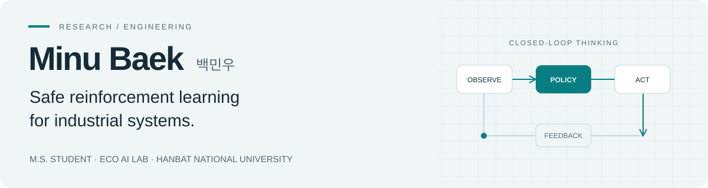

<picture>
  <source media="(prefers-color-scheme: dark)" srcset="https://raw.githubusercontent.com/dovi0129/dovi0129/main/assets/profile-dark.svg" />
  
</picture>

  <a href="https://scholar.google.com/citations?user=ATNX478AAAAJ&amp;hl=ko">Google Scholar</a> &nbsp; / &nbsp;
  <a href="https://ecoailab.github.io/">Eco AI Lab</a> &nbsp; / &nbsp;
  <a href="mailto:bmw5779@o365.hanbat.ac.kr">Email</a>

  <a href="#research">Research</a> &nbsp; · &nbsp;
  <a href="#publications">Publications</a> &nbsp; · &nbsp;
  <a href="#recognition">Recognition</a> &nbsp; · &nbsp;
  <a href="#projects">Projects</a>

## Research

I study **when reinforcement learning can be trusted in industrial control**. My work connects safe policies, physics-grounded digital twins, and uncertainty-aware decisions.

국립한밭대학교 소프트웨어융합대학원 컴퓨터공학과 석사과정 · [Eco AI Lab](https://ecoailab.github.io/)

`Safe & Offline RL` &nbsp; `Digital Twins` &nbsp; `Uncertainty Quantification` &nbsp; `Robotics`

More about my research

My research centers on **safe and trustworthy reinforcement learning for industrial process control**, organized around one question: *when* can a control policy be trusted from real closed-loop operating logs? I combine identifiability and causal diagnosis, physics-grounded digital twins, and uncertainty-calibrated safety layers — deploying RL only where the data supports it, and abstaining when it does not.

- **Safe and offline reinforcement learning** for autonomous industrial process control
- **Identifiability and causal diagnosis** for closed-loop industrial logs — deciding when offline policy learning is reliable, and abstaining when action effects are not identifiable
- **Hybrid, physics-grounded digital twins** for sample-efficient, safe policy learning (validated on a twin built from 11 months of papermaking operation across 687 production lots)
- **Uncertainty quantification and conformal prediction** for surrogate reliability and coverage guarantees
- **Tail-risk-aware, capacity-constrained control** for safety-critical, rare-failure settings
- **LLM- and RAG-based operator support systems** for real-time process monitoring

**Keywords:** `Offline RL` · `Safe RL` · `Causal Identifiability` · `Closed-Loop Confounding` · `Digital Twin` · `Conformal Prediction` · `Tail-Risk` · `Industrial Process Control`

## Publications

- **Carbon-Conformal Manufacturing: Conformal Prediction-Guided Carbon Emission Optimization in Paper-Mill Energy Systems**    
*Applied Energy, Vol. 421, Art. no. 128200, 2026* · [DOI](https://doi.org/10.1016/j.apenergy.2026.128200)

Authors

Gihun Gil, **Minu Baek**, Jio Yoo, Seoyoung Lee, Yeojin Jang, Yoonmee Doh, Jinyoung Choi, Sangkeum Lee

- **Multi-Stage Reinforcement Learning for Robust Charging of Quantum Batteries (Student Abstract)**    
*AAAI 2026 Student Abstract* · [DOI](https://doi.org/10.1609/aaai.v40i48.42264)

Authors

Beomdo Park, Hyeonseok Jang, Junseong Park, **Minu Baek**, Gihun Gil, Minsung Jung, Woohyeon Kwon, Harin Jang, Yeojin Jang, Hoon Jeong, Taewook Heo and Sangkeum Lee

- **DEPLOY-RL: Active Boundary Discovery and Conservative Certification for Deployable Reinforcement Learning in Safety-Critical Continuous Processes**    
*IJCAI-ECAI 2026, AI4Tech Special Track* · [Proceedings](https://www.ijcai.org/proceedings/2026/718)

Authors

Yeojin Jang, **Minu Baek**, Gihun Gil, Minsung Jung, Beomdo Park, Woohyeon Kwon, Hyeonseok Jang, Junseong Park, Neha Sengar, Andres Saurez, Sangkeum Lee

<b>International workshops</b> · KDD & IJCAI

- **Less Can Be Safer: Tail-Risk Reduction via Capacity-Constrained Policies in Industrial Reinforcement Learning**  
  **Minu Baek**, Gihun Gil, Yeojin Jang, Byounghoon Son, Beomdo Park, Minsung Jung, Junseong Park, Hyeonseok Jang and Sangkeum Lee  
  *UDM Workshop @ KDD 2026 · Oral Presentation* · [Program](https://sites.google.com/view/udmkdd26/home)

- **LLM Priors for Sample-Efficient Industrial Control in Digital-Twin Simulation**  
  Gihun Gil, **Minu Baek**, Yeojin Jang, Byounghoon Son, Junseong Park, Beomdo Park, Hyeonseok Jang, Minsung Jung and Sangkeum Lee  
  *AIDataSci@KDD 2026 · Accepted, Poster* · [Paper](https://usail-hkust.github.io/aidatasci/assets/papers/llm-priors-industrial-control.pdf)

- **Structured EXPLAIN Feedback Improves SQL Generation with a 4B SLM on Industrial Time-Series Data**  
  Byounghoon Son, Minsung Jung, Hyeonseok Jang, Beomdo Park, Gihun Gil, Junseong Park, **Minu Baek**, Yeojin Jang and Sangkeum Lee  
  *AIDataSci@KDD 2026 · Accepted, Poster* · [Paper](https://usail-hkust.github.io/aidatasci/assets/papers/structured-explain-feedback.pdf)

- **When Curriculum Becomes Critical: Automated Physics-Grounded Task Progressions for Open Quantum Control**  
  Junseong Park, Hyeonseok Jang, Beomdo Park, Yeojin Jang, **Minu Baek**, Gihun Gil, Byounghoon Son, Minsung Jung and Sangkeum Lee  
  *GLOW Workshop @ IJCAI 2026 · Poster* · [Lab Publications](https://ecoailab.github.io/publications/)

<b>Domestic conferences</b> · KICS & IEIE

- **강화학습 기반 휴머노이드 로봇 손의 제어를 위한 학습 진행 기반 LLM 적응적 개입 스케줄링**  
  Sanghoon Choo, Jihwan Jeon, Giyong Nam, **Minu Baek** and Sangkeum Lee  
  *대한전자공학회 2026 하계 · 포스터*

- **LLM 의사결정과 강화학습 기반 Action Filtering을 활용한 제지공정 이상 대응 프레임워크**  
  Seoyoung Lee, Gihun Gil, Yeojin Jang, **Minu Baek**, Jio Yoo and Sangkeum Lee  
  *대한전자공학회 2026 하계 · 포스터*

- **Conformal Prediction을 이용한 제지공정 수분 Surrogate의 보장률 검증: 영역별 불균형과 Mondrian CP 기반 해소**  
  **Minu Baek**, Gihun Gil, Yeojin Jang, Jio Yoo, Seoyoung Lee, Yoonmee Doh, Jinyoung Choi and Sangkeum Lee  
  *2026 한국통신학회 하계종합학술발표회, 포스터 발표 (2026.06.17 ~ 2026.06.19, 제주)* · **우수논문상(포스터)**

- **산업 IoT 환경에서의 다중 엣지 오프로딩을 위한 강화학습 기법**  
  Yeojin Jang, Gihun Gil, **Minu Baek**, Seoyoung Lee, Jio Yoo and Sangkeum Lee  
  *한국통신학회 2026 하계*

- **LLM 지식 증류 경량 보상 모델을 활용한 제지 공정 자율 운전 강화학습 프레임워크**  
  길기훈, **백민우**, 장여진, 이서영, 유지오, 최진영, 도윤미, 이상금  
  *한국통신학회 2026 하계*

- **CLIP2FL 기반 Long-tail 연합학습을 위한 균형 지식 증류(BKD) 기법**  
  전준, **백민우**, 이상금  
  *한국통신학회 2026 동계*

- **제지공정 강화학습 안전제어를 위한 데이터 기반 운전 영역 정량화 및 품질 영향 분석**  
  **백민우**, 유지오, 길기훈, 이서영, 장여진, 도윤미, 최진영, 이상금  
  *2026 동계 한국통신학회 학술대회, 포스터 세션 (2026.02.04 ~ 2026.02.06)*

- **제지 공정 강화학습에서 GMM 기반 OOD 감지와 계층적 안전 스위칭 정책의 CVaR 기반 위험 관리 효과 분석**  
  유지오, **백민우**, 길기훈, 이서영, 장여진, 이상금  
  *한국통신학회 2026 동계*

- **대규모 산업망의 QoS 보장을 위한 CVaR 기반 위험 민감 강화학습 라우팅 기법**  
  장여진, **백민우**, 길기훈, 이서영, 유지오, 이상금  
  *한국통신학회 2026 동계*

- **제지공정 시계열 데이터의 이상 원인 자동 해석을 위한 LLM 기반 설명 생성 모델 연구**  
  이서영, 장여진, 길기훈, **백민우**, 유지오, 이상금  
  *한국통신학회 2026 동계*

- **강화학습 기반 제지 공정 자율 운전: 초기 안정화 가속화 전략**  
  **백민우**, 유지오, 길기훈, 이서영, 도윤미, 최진영, 이상금  
  *2025 한국통신학회 추계종합학술발표회, 포스터 발표*

- **실시간 제지 공정 운영 효율화를 위한 LLM과 RAG기반 대화형 AI 어시스턴트 설계**  
  길기훈, 이서영, **백민우**, 유지오, 최진영, 도윤미, 이상금  
  *2025 한국통신학회 추계종합학술발표회, 포스터 발표*

## Recognition

| Year | Award |
| :--- | :--- |
| **2026** | **KICS 하계 우수논문상(포스터)** · 제1저자 Conformal Prediction 기반 제지공정 수분 예측 · [수상 목록](https://conf.kics.or.kr/2026f/supportInform#best) |
| **2026.09.21** | **공공데이터 활용 공모전 우수상** 대전권대학 산학협의체 회장상 |
| **2026.06.17** | **KICS 동계 발표 논문 우수논문상** CVaR 기반 위험 민감 강화학습 라우팅 · 하계학회 시상 · [수상 소식](https://www.hanbat.ac.kr/prog/bbsArticle/BBSMSTR_000000000055/view.do?mno=sub07_0404&nttId=B000000167395Yn3yL7p) |
| **2025.11.20** | **KICS 학부생 캡스톤디자인 경진대회 우수상** 생성형 AI 기반 공정 모니터링 서비스 · [수상 소식](https://www.hanbat.ac.kr/prog/bbsArticle/BBSMSTR_000000000053/view.do?mno=sub07_0402&nttId=B000000161188Jw2pV3w) |
| **2025.10.16** | **대전 창의적 종합설계 경진대회 장려상** 딥러닝 기반 딸기 숙성 분류 및 수확 자동화 로봇 |

Activities & certifications

- **2026.08.09** KDD 2026 UDM Workshop 구두발표 (제주)

- **2026.06.17 ~ 2026.06.19** 한국통신학회 하계종합학술발표회 참가 (포스터 발표, 제주)

- **2026.03.06** 데이터분석 준전문가(ADsP) 취득

- **2026.02.05** 통신학회 아이디어 경진대회 참가  
  RL 기반 상황 인지형 적응형 시맨틱 전송 시스템

- **2026.02.04 ~ 2026.02.06** 한국통신학회 동계종합학술발표회 참가 (포스터 발표)

- **2026.01.21 ~ 2026.01.23** AAAI 2026 학회 참가

- **2025.07.07** 산학협력 프로젝트 참여  
  자율주행 주차로봇 운영 소프트웨어 성능 테스트 및 최적화

- **2024.01 ~ 2024.07** 소프트웨어 중심대학 SW특강 3회 (코딩테스트·알고리즘·정보보안)

## Projects

<table>
<tr>
<td width="50%" valign="top">
<h3>PaperRL</h3>

Hybrid digital twins and reinforcement learning for autonomous papermaking process control.

INDUSTRIAL CONTROL · DIGITAL TWINS
</td>
<td width="50%" valign="top">
<h3>Industrial Monitoring Assistant</h3>

Operator support for document retrieval, real-time Q&amp;A, and process monitoring.

REACT · FASTAPI · RAG
</td>
</tr>
<tr>
<td width="50%" valign="top">
<h3>Strawberry Detection &amp; Harvesting</h3>

Vision-based ripeness estimation and a robotic harvesting pipeline for smart agriculture.

COMPUTER VISION · ROBOTICS
</td>
<td width="50%" valign="top">
<h3>Robot Control Stack</h3>

Indy7 and OpenMANIPULATOR-X integration with Jetson Orin Nano and RealSense.

ROS · JETSON · REALSENSE
</td>
</tr>
</table>

## Toolbox

**Learning** · Python, PyTorch, Gymnasium, Stable-Baselines3, d3rlpy, scikit-learn, XGBoost, LightGBM  
**Data** · NumPy, Pandas, Matplotlib, Plotly  
**Systems** · ROS, NVIDIA CUDA, Jetson, Intel RealSense, Git

---

<a href="mailto:bmw5779@o365.hanbat.ac.kr">bmw5779@o365.hanbat.ac.kr</a> &nbsp; · &nbsp; Daejeon, Republic of Korea

